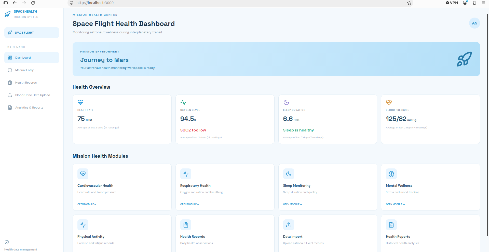
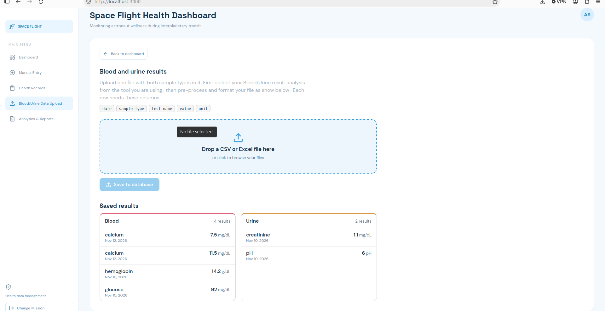
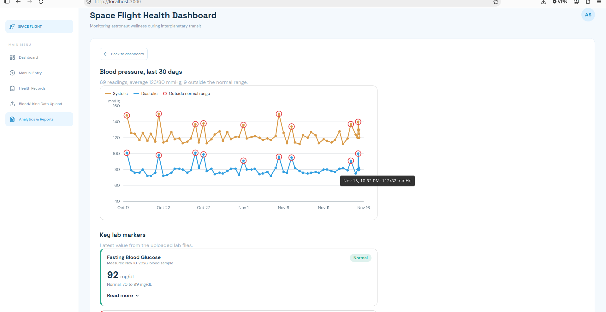

🚀 SpaceHealth | Astronaut Health Monitoring System

SpaceHealth is a web-based astronaut health monitoring platform developed for the NASA Space Apps Challenge 2026.

Challenge: Create Health Monitoring Software for Astronauts on Space Missions.

The application helps astronauts and mission support teams monitor health and wellness during long-duration Mars missions. It supports two mission environments: Interplanetary Space Flight and Mars Surface, with separate health records and mission-aware dashboards.

✨ Features
🚀 Mission Selection: Dedicated environments for Space Flight and Mars Surface.
🩺 Health Monitoring: Record blood pressure, heart rate, SpO2, body temperature, weight, and health notes.
⚠️ Automatic Health Alerts: Identify abnormal heart rate, oxygen saturation, and blood pressure averages using the last 2 days of readings.
😴 Sleep Tracking: Monitor sleep using a 7-day average, with warnings below 6 hours.
📊 Health Analytics: Visualise health trends and a 30-day blood pressure chart.
🧪 Laboratory Data Upload: Upload blood and urine test results.
🔬 Lab Result Analysis: Colour-coded indicators for glucose, calcium, and creatinine, with plain-language guidance.
💾 Data Management: Store health records using SQLite with separate mission records.
🖥️ Application Screenshots
1. Main Dashboard

2. Manual Health Data Entry

3. Health Data CSV Upload

4. Reports and Health Parameters

🛠️ Technology Stack
Technology	Purpose
React	Frontend development
Vite	Frontend development server
Lucide Icons	UI icons
Python	Backend development
FastAPI	REST API
SQLAlchemy	Database ORM
SQLite	Health-data storage
📁 Project Structure
text
spacehealth/
│
├── backend/
│   ├── app/
│   ├── uploads/
│   ├── health_records.db
│   ├── requirements.txt
│   └── .env
│
├── frontend/
│   ├── src/
│   ├── public/
│   └── package.json
│
├── docs/
│   └── screenshots/
│       ├── dashboard.png
│       ├── manual_heath_data_entry'.png
│       ├── Health_data_CSV_Upload.png
│       └── Reports_Details_of_Heath_Parameters.png
│
├── .gitignore
└── README.md

🚀 Installation and Setup
Prerequisites
Python 3
Node.js and npm
Git
1. Clone the Repository
bash
git clone YOUR_GITHUB_REPOSITORY_URL
cd spacehealth

2. Start the Backend
bash
cd backend

python3 -m venv venv
source venv/bin/activate

pip install -r requirements.txt

uvicorn app.main:app --reload

Backend: http://127.0.0.1:8000

API Documentation: http://127.0.0.1:8000/docs

3. Start the Frontend

Open a new terminal:

bash
cd frontend

npm install
npm run dev

Open the Vite development URL, usually:

http://localhost:5173

🗄️ Database

SpaceHealth uses SQLite for local data storage and SQLAlchemy for database operations.

Health records include vital signs, sleep information, notes, laboratory results, and mission-specific information.

🔒 Privacy
Do not commit .env files containing secrets.
Do not commit the Python virtual environment.
Avoid publishing personal health records or sensitive uploaded files.
Protect database backups and uploaded health information.
⚠️ Disclaimer

SpaceHealth is a demonstration health-monitoring application and is not a certified medical device.

Health ranges, alerts, and recommendations are for demonstration purposes only and do not constitute medical advice. Actual medical thresholds and interventions must be determined by qualified flight surgeons and healthcare professionals.

👨‍💻 Author

Mriganka Saikia

Developed for the NASA Space Apps Challenge 2026.

⭐ If you find this project interesting, consider giving the repository a star!
